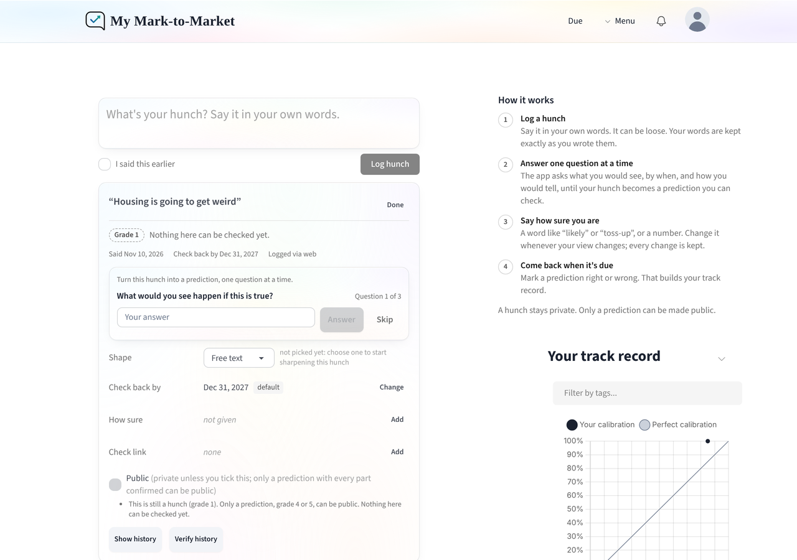
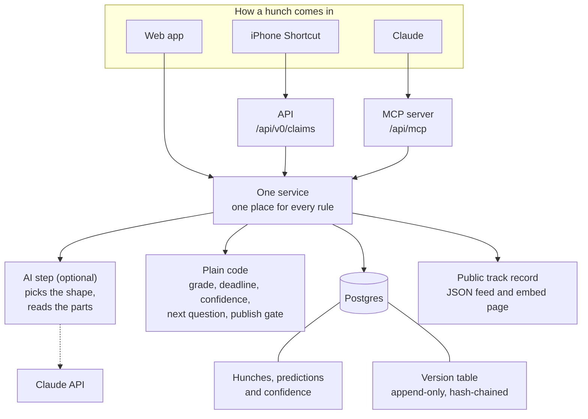
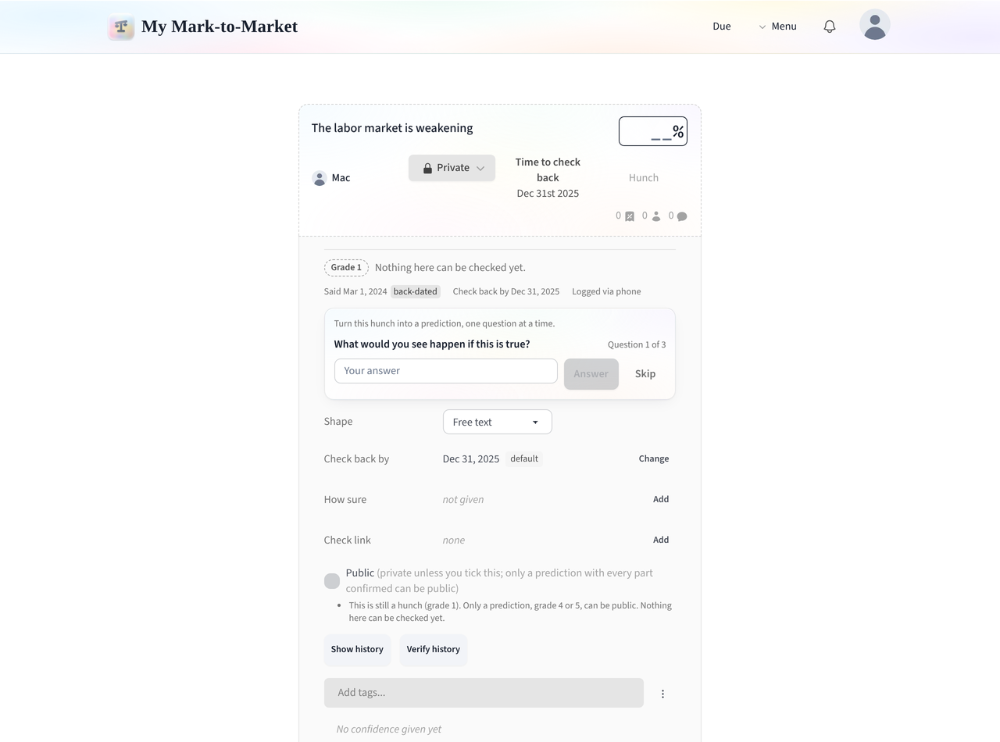
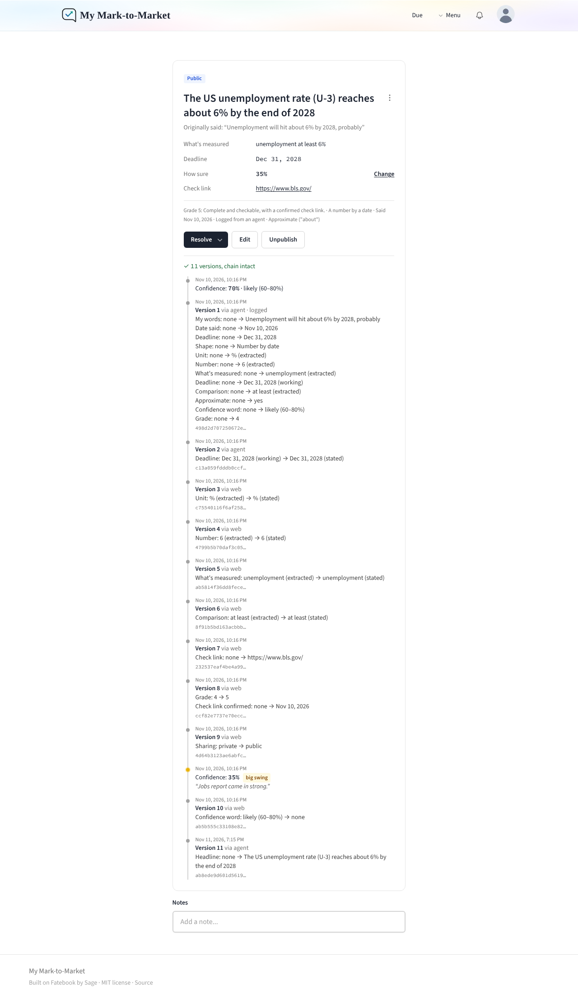
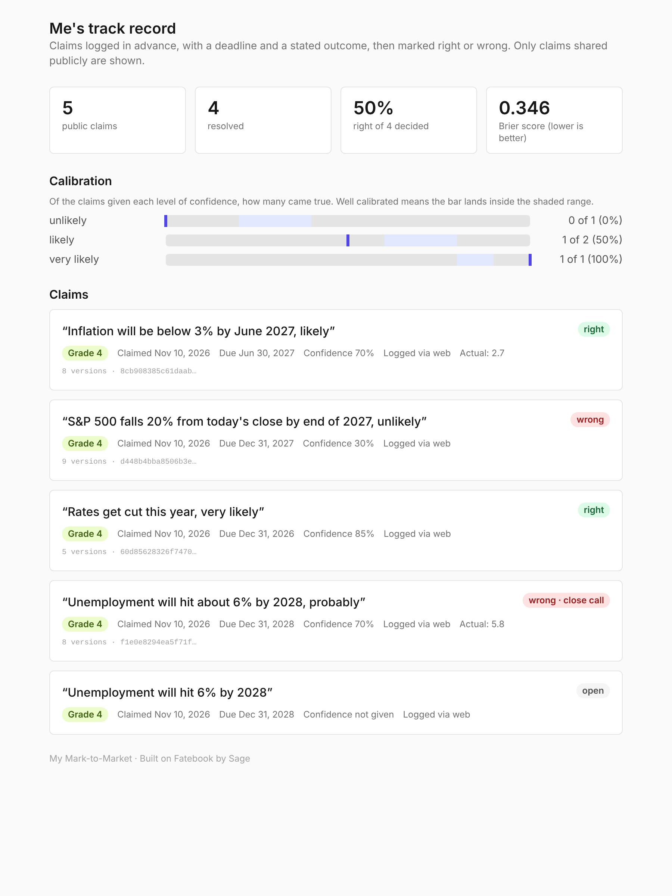

# My Mark-to-Market

A personal tracker for my hunches and predictions: what I said, when I said it, how sure I was, and how it turned out.

Built on [Fatebook](https://fatebook.io) by [Sage](https://sage-future.org), under the [MIT license](LICENSE).



## What it is and why I built it

I voice a lot of hunches in conversation: "the labor market is weakening", "rates get cut this year". Most are too vague to ever be shown right or wrong, which makes it easy to remember the hits and forget the misses.

This app is where I write those down in my own words, at the moment I say them. It uses two words. A **hunch** is anything I log; it can be loose, and it stays private. A **prediction** is a hunch sharpened until it can be checked: an outcome, a deadline and a way to tell. The app asks one question at a time to help turn a hunch into a prediction, and grades how checkable it is: grades 1 to 3 are hunches, grades 4 and 5 are predictions. Only predictions can be made public and scored, and every change I make is kept in a history I cannot quietly edit.

In the code, the API paths and the tool names, both are called a "claim". That is the internal name only.

It is for my own use. It does not track what other people say, and has no social features and no markets.

It is also a portfolio piece: I took a working open-source app, read it, and extended it without rewriting it.

## What Fatebook already did, and what I added

**Fatebook already did**

- Questions with a title, a resolve-by date, notes and tags
- A probability forecast you can update, with every update kept
- Resolving as yes, no or ambiguous
- Brier scoring and a calibration chart
- Sign-in, an API with keys, embeddable question pages
- Slack and Discord bots, a browser extension, teams and tournaments

**I added**

|                              | What                                                                                                                                                                                                                                                                                                                                                 | Where                                                                          |
| ---------------------------- | ---------------------------------------------------------------------------------------------------------------------------------------------------------------------------------------------------------------------------------------------------------------------------------------------------------------------------------------------------- | ------------------------------------------------------------------------------ |
| A standard for what I said   | The text kept in my own words, the date I said it separate from the logged date, and an outcome stored as one of five shapes with the parts that shape needs                                                                                                                                                                                         | `lib/claims/types.ts`                                                          |
| A headline over my words     | Claude (or the AI step) rewrites what I said into one clear, sharp sentence. I approve or steer it, and the approved headline is what shows everywhere. My raw words are saved underneath, unchanged, and shown as "Originally said" (on the public track record too, behind a toggle under each headline). An entry with no headline shows my words | `lib/claims/service.ts`, `components/claims/PreviewCard.tsx`                   |
| Honest provenance            | Every outcome part is marked _stated_ (I said it), _extracted_ (the AI read it from my text) or _working_ (a default I accepted), and I can confirm each one                                                                                                                                                                                         | `components/claims/ClaimPanel.tsx`                                             |
| A grade from 1 to 5          | Plain code, no AI: the same words always get the same grade. An outcome that is really two predictions ("if … then", "and/or") or an event with no stated way to tell stays below grade 4. Sharper terms than mine in the outcome are fine: that is the point                                                                                        | `lib/claims/grade.ts`                                                          |
| One question at a time       | The most important gap, with a one-tap default where one makes sense, and never more than three                                                                                                                                                                                                                                                      | `lib/claims/next_question.ts`                                                  |
| Confidence words             | "likely", "toss-up", "almost no chance" and so on, each mapped to a range; and a rule for when a percentage is confidence and when it is just a number in the text                                                                                                                                                                                   | `lib/claims/confidence.ts`                                                     |
| Deadlines from the date said | "This year" in a hunch voiced in July 2025 means December 31, 2025, whenever I log it                                                                                                                                                                                                                                                                | `lib/claims/dates.ts`                                                          |
| My time zone                 | "Today", the date I said something, due lines and the daily job all use the time zone saved on my account (default America/Chicago), so an entry logged at 8:30pm is dated that day, not the next. API and connector calls can pass their own                                                                                                        | `lib/claims/timezone.ts`                                                       |
| Close calls                  | "About 6%" that lands at 5.8% is scored wrong, and marked as a near miss                                                                                                                                                                                                                                                                             | `lib/claims/tolerance.ts`                                                      |
| A publish gate               | Private by default. Public only at grade 4 or 5 with every part confirmed. An edit that would break that is blocked, never silently fixed                                                                                                                                                                                                            | `lib/claims/service.ts`                                                        |
| Append-only history          | Every change writes a full snapshot, chained to the one before by a hash, with a button that re-checks the chain                                                                                                                                                                                                                                     | `lib/claims/history.ts`                                                        |
| Where it came from           | A link from a prediction back to the hunch it grew out of                                                                                                                                                                                                                                                                                            | `lib/claims/service.ts`                                                        |
| Preview before saving        | With Claude, and on the web when the AI step is on, the proposed sharpening is shown first with the grade it would get. Nothing is saved until I approve it; what I approve is saved as mine, dated when I first said it                                                                                                                             | `previewClaim` in `lib/claims/service.ts`, `components/claims/PreviewCard.tsx` |
| Logging from anywhere        | API endpoints, a hosted MCP server for Claude, and an iPhone Shortcut. Each item records how it came in: web, API, phone or agent                                                                                                                                                                                                                    | `lib/web/claims_api_router.ts`, `lib/mcp/server.ts`                            |
| A public track record        | A JSON feed and an embeddable page showing only the predictions I have shared                                                                                                                                                                                                                                                                        | `lib/claims/public_record.ts`                                                  |

**I changed in Fatebook itself**

- The site address comes from an environment variable instead of being fixed to `fatebook.io`.
- API keys are generated securely, stored only as a hash, and can be sent in a header.
- Delete became "withdraw": hidden everywhere, but kept with its history.
- Slack, Discord, the browser extension, teams, tournaments, the public feed and Sage's own pages are switched off behind flags in `lib/features.ts`. No code was deleted; setting a flag to `true` brings a feature back.
- GitHub now runs the type check, lint and database tests, not only the unit tests.

## How it fits together



The important line is the one in the middle. The web app, the API and the MCP server all call the same service (`lib/claims/service.ts`), so they cannot disagree about a grade, the publish gate or what goes into the history.

The AI step is deliberately small. It picks the shape of the outcome and reads the parts out of my text, and everything it returns is marked "extracted" until I confirm it. It does not grade, does not decide the deadline and does not read my confidence; plain code does those, so the answers are repeatable. Without an API key the app works the same and I fill the fields in by hand.

## What it looks like

**A hunch.** Grade 1 and private. The app asks what I would actually see, and my answer moves it up a grade.



**The timeline and history check.** Every version, what changed, how it came in, and the result of recomputing the hash chain.



**The public track record.** Only predictions I have made public. This is the page my own site embeds.



_These screenshots were taken from the app running locally, with a stand-in for the Claude API returning the shape and parts._

## What the history does and does not prove

Each history row stores a hash of its own contents and of the row before it. If any row is changed, removed or reordered, the chain stops matching, and "Verify history" says at which version.

This **detects** tampering. It cannot **prevent** it. There are two layers: the database itself rejects any edit or delete on the history table, and if someone with full database access switches that off, the hash chain shows the damage.

Someone with full database access could still rewrite a row and recompute every hash after it. The guard against that is outside the database: the public feed publishes each public prediction's latest hash, so a rewritten history would no longer match what my site, or anyone who saved the feed, has on record.

## Run it locally

You need Docker and Node 20.

```shell
git clone https://github.com/mfaldet/my-mark-to-market.git
cd my-mark-to-market
cp .env.example .env
docker compose up
```

Open http://localhost:3000. To sign in, choose the email option and pick up the sign-in email from the local mail catcher at http://localhost:8025.

If you would rather run the app outside Docker and keep only the database and mail catcher in it:

```shell
docker compose up -d db mail
npm install
npx prisma migrate deploy
NEXTAUTH_URL=http://localhost:3000/api/auth HOST_URL=http://localhost:3000 \
AUTH_EMAIL_SERVER=smtp://localhost:1025 AUTH_EMAIL_FROM=app@localhost \
npx dotenv -- next dev -p 3000
```

To switch the AI step on, add `ANTHROPIC_API_KEY=...` to `.env`. It uses a small model by default; set `CLAIM_AI_MODEL` to change it.

### Tests

```shell
npm test                                    # unit tests, no database needed
RUN_DB_TESTS=1 npx dotenv -- npx jest       # also the tests that use Postgres
RUN_LIVE_AI=1 npx dotenv -- npx jest extract.live   # the AI step against the real API (needs a key)
```

## Deploy it

It is built for Vercel plus a hosted Postgres. Set at least:

| Variable                               | What it is                                                                               |
| -------------------------------------- | ---------------------------------------------------------------------------------------- |
| `DATABASE_URL`, `DATABASE_DIRECT_URL`  | Your Postgres                                                                            |
| `SECRET`                               | Any long random string                                                                   |
| `NEXT_PUBLIC_BASE_URL`                 | Your public address, e.g. `https://claims.example.com`                                   |
| `NEXTAUTH_URL`                         | The same address followed by `/api/auth`                                                 |
| `AUTH_EMAIL_SERVER`, `AUTH_EMAIL_FROM` | An SMTP account for sign-in emails, or use `GOOGLE_CLIENT_ID` and `GOOGLE_CLIENT_SECRET` |
| `CRON_SECRET`                          | Any long random string. Lets Vercel run the daily "ready to resolve" job                 |
| `ALLOWED_SIGNIN_EMAILS`                | Your own email address. Stops anyone else signing in or creating an account              |
| `ANTHROPIC_API_KEY`                    | Optional. Switches the AI step on                                                        |

`.env.example` lists every variable, including the feature switches.

Two things that will fail a deploy:

- **Do not set `NODE_ENV`** in Vercel. The build sets it itself; forcing `development` breaks it with "NextRouter was not mounted".
- **Only `main` is deployed.** `vercel.json` tells Vercel not to build any other branch. The build applies database migrations, so a preview build of an unmerged branch would either fail for lack of a database or run its migrations against the real one. Keep the database variables set for Production only.

## Connect Claude and your phone

- **Claude** (Claude Code, and the web, desktop and phone apps): [docs/connect-claude.md](docs/connect-claude.md)
- **iPhone Shortcut** that dictates a hunch and shows the app's first question: [docs/iphone-shortcut.md](docs/iphone-shortcut.md)
- **Your own scripts:** sign in and open **Connect** in the menu for your key and interactive documentation of every endpoint.

## Honest limits

- The AI step has been tested with a stand-in for the Claude API, not yet against the real one. `extract.live.test.ts` does that once a key is available.
- The MCP server is tested with the official MCP client library. I have used it from the Claude app for my first real entries; what that showed (dates a day ahead, compound outcomes graded as predictions) is fixed and covered by tests built from those entries.
- The check for "more than one prediction" is pattern matching, not understanding. It will miss some cases and occasionally stop a fine one.
- Nothing checks that a headline or outcome means the same thing as my raw words. That is deliberate: sharpening is the point, I approve every headline, and my raw words stay on record beside it.
- The iPhone Shortcut instructions have not been built on a phone.
- The MCP server signs in with an API key. It does not implement OAuth.
- Confidence words are read by plain pattern matching, so a word that is part of the hunch itself ("the Fed says a cut is likely") is read as my confidence. The app shows what it read so I can correct it.

## Credit and license

This is a fork of [Fatebook](https://github.com/Sage-Future/fatebook), made by [Sage](https://sage-future.org). The forecasting, scoring, calibration, sign-in and most of the interface are their work, and I am grateful they published it openly. Fatebook's original README is kept at [docs/FATEBOOK_README.md](docs/FATEBOOK_README.md).

Both Fatebook and this fork are released under the [MIT license](LICENSE).
