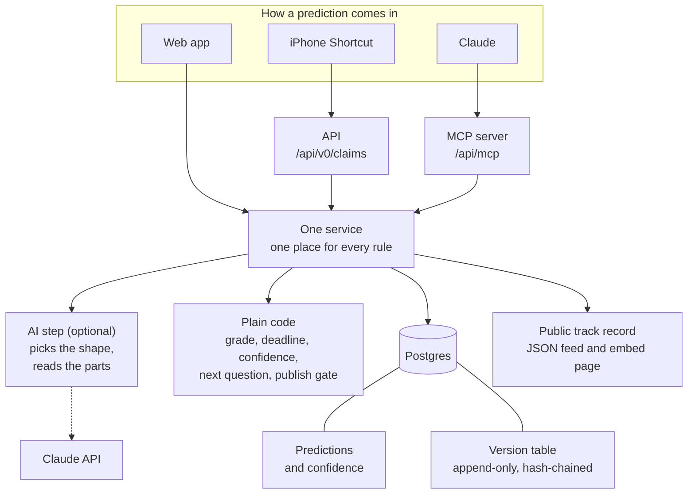
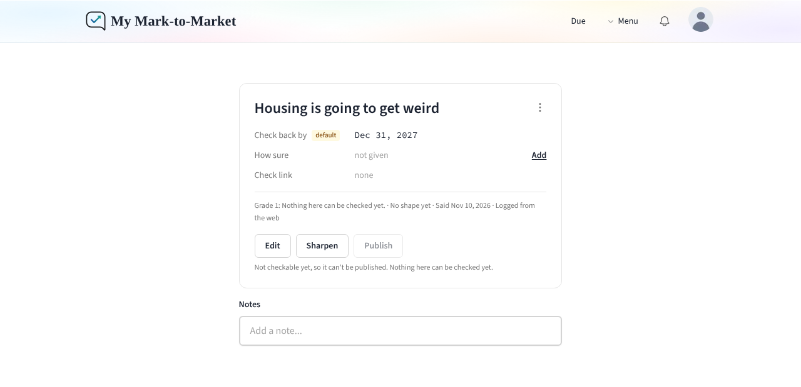

# My Mark-to-Market

[](https://github.com/mfaldet/my-mark-to-market/actions/workflows/test.yml)

A personal tracker for my predictions: what I said, when I said it, how sure I was, and how it turned out.

**[Open the live app](https://my-mark-to-market.vercel.app)** (sign-in is limited to me) · **[My public track record](https://faldetadvisory.com/track-record)**

Built on [Fatebook](https://fatebook.io) by [Sage](https://sage-future.org), under the [MIT license](LICENSE).

## At a glance

- **What it is.** A place to write down a prediction in my own words the moment I say it, sharpen it until it can be checked, and later mark it right or wrong.
- **What I added to Fatebook.** A standard for what counts as a checkable prediction, a 1 to 5 grade worked out by plain code, a clean headline over my raw words, and a public track record. [The full list is below.](#what-fatebook-already-did-and-what-i-added)
- **How predictions come in.** The web app, Claude (through a built-in MCP server) and an iPhone Shortcut. All three go through one service, so the rules are the same everywhere.
- **A locked history.** Every change is a new version, chained to the one before by a hash. The database refuses edits and deletes, and a daily backup re-checks every chain. [What that does and does not prove.](#what-the-history-does-and-does-not-prove)
- **Tests.** About 480 automated tests, including ones that run against a real Postgres. GitHub runs the type check, lint and all of them on every change.


## What it is and why I built it

I make a lot of loose predictions in conversation: "the labor market is weakening", "rates get cut this year". Most are too vague to ever be shown right or wrong, which makes it easy to remember the hits and forget the misses.

This app is where I write those down in my own words, at the moment I say them. It uses one word: everything I log is a **prediction**, however loose. A grade from 1 to 5 says how checkable it is. Grades 4 and 5 are checkable: one outcome, a deadline and a way to tell. The app proposes a clear headline and the parts that would make a prediction checkable, and I approve or edit them. Every prediction is private until I publish it, only a checkable one can be published and scored, and every change I make is kept in a history I cannot quietly edit.

In the code, the API paths and the tool names, a prediction is called a "claim". That is the internal name only. One field, `kind`, still answers "hunch" for grades 1 to 3 and "prediction" for grades 4 and 5, so existing setups keep working. The entry box still asks "What's your hunch?", because that is how a prediction usually starts.

It is for my own use. It does not track what other people say, and has no social features and no markets.

It is also a portfolio piece: I took a working open-source app, read it, and extended it without rewriting it.

## What Fatebook already did, and what I added

**Fatebook already did**

- Questions with a title, a resolve-by date, notes and tags
- A probability forecast you can update, with every update kept
- Resolving as yes, no or ambiguous
- Brier scoring and a calibration chart
- Sign-in, an API with keys, embeddable question pages
- Slack and Discord bots, a browser extension, teams and tournaments

**I added**

One line each. [More detail on each row](docs/what-i-added.md).

|                              | What                                                                       | Where                                  |
| ---------------------------- | -------------------------------------------------------------------------- | -------------------------------------- |
| A standard for what I said   | My words, the date I said them, and an outcome in one of five shapes       | `lib/claims/types.ts`                  |
| A headline over my words     | A clean sentence I approve, shown everywhere; my raw words kept underneath | `lib/claims/service.ts`                |
| Honest provenance            | Every outcome part is marked as stated by me, read by the AI, or a default | `components/claims/ClaimPanel.tsx`     |
| A grade from 1 to 5          | Plain code, no AI: the same words always get the same grade                | `lib/claims/grade.ts`                  |
| Sharpening a prediction      | The app proposes a headline and parts; nothing changes until I approve     | `components/claims/card/ClaimCard.tsx` |
| Confidence words             | "likely", "toss-up" and so on, each mapped to a range                      | `lib/claims/confidence.ts`             |
| Deadlines from the date said | "This year" means the year I said it, whenever I log it                    | `lib/claims/dates.ts`                  |
| My time zone                 | Dates follow the time zone saved on my account                             | `lib/claims/timezone.ts`               |
| Close calls                  | "About 6%" landing at 5.8% is wrong, and marked a near miss                | `lib/claims/tolerance.ts`              |
| Publish and unpublish        | Private until I publish; only a checkable one, fully confirmed, can be     | `lib/claims/service.ts`                |
| Append-only history          | Every change is a full snapshot in a hash chain that can be re-checked     | `lib/claims/history.ts`                |
| Where it came from           | A link from a prediction back to the looser one it grew out of             | `lib/claims/service.ts`                |
| Preview before saving        | The sharpening is shown first; nothing is saved until I approve            | `components/claims/PreviewCard.tsx`    |
| Daily backups                | A read-only export behind its own token, kept in a private repo            | `lib/backup/export.ts`                 |
| Logging from anywhere        | An API, an MCP server for Claude and an iPhone Shortcut                    | `lib/mcp/server.ts`                    |
| A public track record        | A JSON feed and a page showing only predictions I have published           | `lib/claims/public_record.ts`          |

**I changed in Fatebook itself**

- The site address comes from an environment variable instead of being fixed to `fatebook.io`.
- API keys are generated securely, stored only as a hash, and can be sent in a header.
- **A security fix.** Fatebook shipped the key for its scheduled jobs inside `vercel.json`, in a public repo, and a request with no key at all was let through whenever the key was not set on the server. Both are fixed here: the secret (`CRON_SECRET`) lives only in the server's settings and is sent in a header, and with no secret set every request is refused (`lib/cron_auth.ts`). I reported it to Sage privately.
- Delete became "withdraw": hidden everywhere, but kept with its history.
- Slack, Discord, the browser extension, teams, tournaments, the public feed and Sage's own pages are switched off behind flags in `lib/features.ts`. No code was deleted; setting a flag to `true` brings a feature back.
- GitHub now runs the type check, lint and database tests, not only the unit tests.

## How it fits together



The important line is the one in the middle. The web app, the API and the MCP server all call the same service (`lib/claims/service.ts`), so they cannot disagree about a grade, the publish gate or what goes into the history.

The AI step is deliberately small. It picks the shape of the outcome, reads the parts out of my text and proposes a headline, and everything it returns is marked "extracted" and shown as a preview until I approve it. It does not grade, does not decide the deadline and does not read my confidence; plain code does those, so the answers are repeatable. Without an API key the app works the same and I fill the fields in by hand.

## What it looks like

**A loose prediction.** Not checkable yet, private, and fine left that way. "Sharpen" asks the app for a clear headline and the parts that would make it checkable; nothing changes until I approve.



**A prediction with a headline.** The approved headline on top, my original words underneath, and the timeline: every version, what changed, how it came in, and the result of recomputing the hash chain.


**The public track record.** Only predictions I have published. My own site does not embed the app's page: it reads the public feed and draws its own page, with a timeline grouped by story. [See the live page.](https://faldetadvisory.com/track-record)


_These screenshots were taken from the app running locally with test entries, and a stand-in for the Claude API proposing the headline and parts._

## What the history does and does not prove

Each history row stores a hash of its own contents and of the row before it. If any row is changed, removed or reordered, the chain stops matching, and "Verify history" says at which version.

This **detects** tampering. It cannot **prevent** it. There are two layers: the database itself rejects any edit or delete on the history table, and if someone with full database access switches that off, the hash chain shows the damage.

Someone with full database access could still rewrite a row and recompute every hash after it. The guard against that is outside the database: the public feed publishes each public prediction's latest hash, so a rewritten history would no longer match what my site, or anyone who saved the feed, has on record.

## Run it locally

You need Docker and Node 20.

```shell
git clone https://github.com/mfaldet/my-mark-to-market.git
cd my-mark-to-market
cp .env.example .env
docker compose up
```

Open http://localhost:3000. To sign in, choose the email option and pick up the sign-in email from the local mail catcher at http://localhost:8025.

If you would rather run the app outside Docker and keep only the database and mail catcher in it:

```shell
docker compose up -d db mail
npm install
npx prisma migrate deploy
NEXTAUTH_URL=http://localhost:3000/api/auth HOST_URL=http://localhost:3000 \
AUTH_EMAIL_SERVER=smtp://localhost:1025 AUTH_EMAIL_FROM=app@localhost \
npx dotenv -- next dev -p 3000
```

To switch the AI step on, add `ANTHROPIC_API_KEY=...` to `.env`. It uses a small model by default; set `CLAIM_AI_MODEL` to change it. If the step is asked and adds nothing, the answer to that log or preview says why.

### Tests

```shell
npm test                                    # unit tests, no database needed
RUN_DB_TESTS=1 npx dotenv -- npx jest       # also the tests that use Postgres
RUN_LIVE_AI=1 npx dotenv -- npx jest extract.live   # the AI step against the real API (needs a key)
```

## Deploy it

It is built for Vercel plus a hosted Postgres. Set at least:

| Variable                               | What it is                                                                                                                                                                |
| -------------------------------------- | ------------------------------------------------------------------------------------------------------------------------------------------------------------------------- |
| `DATABASE_URL`, `DATABASE_DIRECT_URL`  | Your Postgres                                                                                                                                                             |
| `SECRET`                               | Any long random string                                                                                                                                                    |
| `NEXT_PUBLIC_BASE_URL`                 | Your public address, e.g. `https://claims.example.com`                                                                                                                    |
| `NEXTAUTH_URL`                         | The same address followed by `/api/auth`                                                                                                                                  |
| `AUTH_EMAIL_SERVER`, `AUTH_EMAIL_FROM` | An SMTP account for sign-in emails, or use `GOOGLE_CLIENT_ID` and `GOOGLE_CLIENT_SECRET`                                                                                  |
| `CRON_SECRET`                          | Any long random string. Lets Vercel run the daily "ready to resolve" job                                                                                                  |
| `ALLOWED_SIGNIN_EMAILS`                | Your own email address. Stops anyone else signing in or creating an account                                                                                               |
| `ANTHROPIC_API_KEY`                    | Optional. Switches the AI step on                                                                                                                                         |
| `BACKUP_TOKEN`                         | Optional. Any long random string, different from the others. Lets the daily backup read everything from `/api/backup/export`; without it the export refuses every request |

`.env.example` lists every variable, including the feature switches.

Two things that will fail a deploy:

- **Do not set `NODE_ENV`** in Vercel. The build sets it itself; forcing `development` breaks it with "NextRouter was not mounted".
- **Only `main` is deployed.** `vercel.json` tells Vercel not to build any other branch. The build applies database migrations, so a preview build of an unmerged branch would either fail for lack of a database or run its migrations against the real one. Keep the database variables set for Production only.

## Connect Claude and your phone

- **Claude** (Claude Code, and the web, desktop and phone apps): [docs/connect-claude.md](docs/connect-claude.md)
- **iPhone Shortcut** that takes a prediction by voice or keyboard, lets me check it, and shows the grade: [docs/iphone-shortcut.md](docs/iphone-shortcut.md)
- **Your own scripts:** sign in and open **Claude, iPhone and scripts** in the menu for your key and interactive documentation of every endpoint.

## Honest limits

- The app's own AI step first ran against the real AI service on November 12, 2026. Until then it had only been tested with a local stand-in, which is how a mistake in the answer format I sent went unnoticed: the real service rejected every request, and the app quietly fell back to saving my words alone. The stand-in cannot catch that kind of mistake. The answer to each log or preview now says why whenever the step adds nothing, and a test guards the format. `extract.live.test.ts` runs the step against the real service, but only on a machine that has a key.
- The MCP server is tested with the official MCP client library, and I use it from the Claude app for my real entries. What the first ones showed (dates a day ahead, compound outcomes graded as predictions) is fixed and covered by tests built from those entries.
- The iPhone Shortcut is built and in use on my own phone. It has been tried on one phone and one iOS version.
- The check for "more than one prediction" is pattern matching, not understanding. It will miss some cases and occasionally stop a fine one.
- Nothing checks that a headline or outcome means the same thing as my raw words. That is deliberate: sharpening is the point, I approve every headline, and my raw words stay on record beside it.
- The MCP server signs in with an API key. It does not implement OAuth.
- Confidence words are read by plain pattern matching, so a word that is part of the prediction itself ("the Fed says a cut is likely") is read as my confidence. The app shows what it read so I can correct it.

## Credit and license

This is a fork of [Fatebook](https://github.com/Sage-Future/fatebook), made by [Sage](https://sage-future.org). The forecasting, scoring, calibration, sign-in and most of the interface are their work, and I am grateful they published it openly. Fatebook's original README is kept at [docs/FATEBOOK_README.md](docs/FATEBOOK_README.md).

Both Fatebook and this fork are released under the [MIT license](LICENSE).
